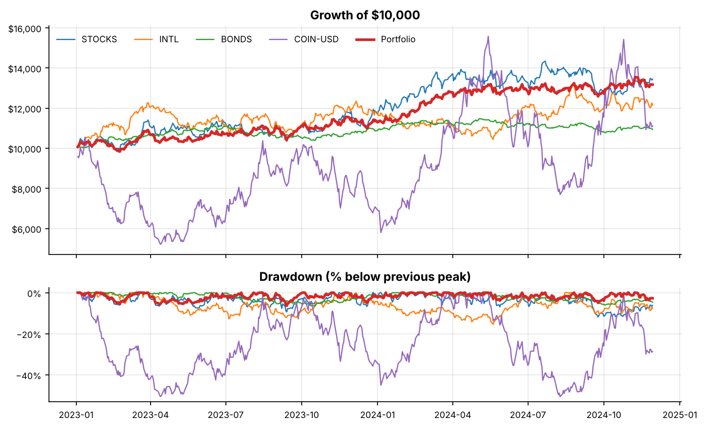
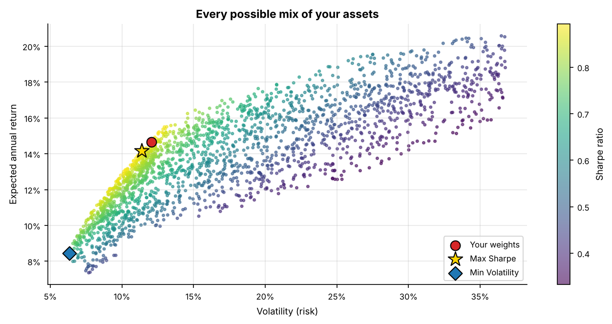

# Portfolio Analyzer


A free, open-source tool that measures the **risk and return of any stock, ETF or crypto portfolio**, finds the **max-Sharpe mix**, calculates **Value at Risk**, and exports a **PDF report**, all from a simple web page.



*Example output using the synthetic data in `examples/sample_prices.csv`. See the full [sample PDF report](examples/sample_report.pdf).*

## Features

| | What you get |
|---|---|
| **Plain-English summary** | A few sentences at the top that explain the results to anyone |
| **Return & risk** | Annual return (CAGR), volatility, Sharpe, Sortino, max drawdown, beta, Calmar |
| **Value at Risk** | 1-day and 1-month historical VaR, CVaR (expected shortfall), parametric VaR, in % and $ |
| **Optimizer** | Max-Sharpe and minimum-volatility weights (long-only), with an optional cap per asset |
| **Efficient frontier** | Thousands of possible mixes plotted, with your portfolio and the optimal ones marked |
| **Crypto** | BTC, ETH, XRP, SOL, BNB, ADA, DOGE, AVAX, LINK, LTC built in, mixed correctly with stocks |
| **PDF report** | One click: summary, all tables and all charts, ready to print or email |
| **Rebalancing** | Daily, monthly, quarterly, yearly, or never (buy and hold, like a brokerage or Bloomberg shares portfolio) |
| **Benchmark comparison** | Your total return vs. the benchmark (e.g. IVV), in percentage points |
| **Presets** | Vanguard core 60/30/10, classic 60/40, three-fund, crypto majors, stocks + 10% crypto |



## Quick start (Windows)

```bash
py -m pip install -r requirements.txt
py -m streamlit run app.py
```

The app opens in your browser. Pick a preset or your own assets, set weights, and press **Analyze**.

### Command line

```bash
py -m portfolio_analyzer.cli VOO VXUS BND --weights 0.6 0.3 0.1 --benchmark VOO
py -m portfolio_analyzer.cli --preset "Crypto majors" --pdf crypto_report.pdf
py -m portfolio_analyzer.cli VOO BND BTC-USD --max-weight 0.5 --var-level 0.99
py -m portfolio_analyzer.cli --preset "SMIF_ZR - Project 2 stocks" --start 2025-12-31 --rebalance none --benchmark IVV
```

### Checked against Bloomberg

For the 20-stock SMIF_ZR portfolio (buy and hold from 12/31/25 to 10/30/26), the tool gives a total return of **44.90%** vs. Bloomberg PORT's **44.84%**, and **11.75%** for IVV in both. The fixed-weight sector portfolio matches Bloomberg exactly (26.54%). Small gaps come from Yahoo vs. Bloomberg dividend timing.

Run `py -m portfolio_analyzer.cli --help` to see every option.

### As a Python library

```python
from portfolio_analyzer import analyze, plain_english
from portfolio_analyzer.data import fetch_prices
from portfolio_analyzer.report import build_pdf

prices = fetch_prices(["VOO", "BND", "BTC-USD"], start="2021-01-01")
a = analyze(prices, {"VOO": 0.6, "BND": 0.3, "BTC-USD": 0.1}, risk_free=0.04)
print("\n".join(plain_english(a)))
print(a.optimal)          # your weights vs. max Sharpe vs. min volatility
open("report.pdf", "wb").write(build_pdf(a))
```

## How crypto is handled

- Yahoo Finance crypto tickers end in **-USD** (e.g. `BTC-USD`, `SOL-USD`). Typing a full name such as `solana` also works.
- Crypto trades 7 days a week and stocks 5. **Crypto-only** portfolios are annualised with 365 days; **mixed** portfolios use stock-market days only (weekend crypto moves land in Monday's return), annualised with 252.
- If one asset has a shorter history (e.g. a newer coin), the whole analysis starts on its first day so every number covers the same period.

## Formulas

- Daily excess return: `r − rf / N` where `N` = 252 (stocks/mixed) or 365 (crypto only)
- Sharpe: `mean(excess) / std(excess) × √N`
- Sortino: `mean(excess) / downside deviation × √N`
- Max drawdown: `min(wealth_t / peak_t − 1)`
- Beta: `cov(r, r_benchmark) / var(r_benchmark)`
- Historical VaR (95%): the 5th-percentile daily loss; CVaR = average loss beyond it; multi-day = `VaR × √days`
- Max Sharpe: maximise `(w·μ − rf) / √(wᵀΣw)` subject to `Σw = 1`, `0 ≤ w ≤ cap` (SciPy SLSQP)

## Project layout

```
portfolio_analyzer/
  analysis.py   # analyze(): runs everything; used by the app, CLI and PDF
  metrics.py    # return & risk-adjusted metrics
  risk.py       # VaR, CVaR
  optimize.py   # max-Sharpe, min-volatility, efficient frontier
  data.py       # Yahoo Finance download, CSV loader, stock/crypto date alignment
  universe.py   # ticker list and presets (add a line to add an asset)
  plots.py      # all charts
  report.py     # PDF report
  cli.py        # command line
app.py          # Streamlit web app
tests/          # 33 tests, run automatically on every change by GitHub Actions
```

**Adding things:** new asset to the picker: one line in `universe.CATALOG`. New preset: one entry in `universe.PRESETS`. New metric: add it in `analysis.analyze()` and it appears in the app, CLI and PDF.

## Roadmap

- [ ] Monte Carlo simulation of future portfolio value
- [ ] Stress tests (2008, 2020, 2022 drawdowns)
- [ ] Factor exposure (market, size, value)
- [ ] Hosted version on Streamlit Community Cloud

## Running tests

```bash
py -m pytest -q
```

## Disclaimer

For education and research only. This is not investment advice. Optimised weights describe what worked best in the past, not what will work in the future. Price data comes from Yahoo Finance via `yfinance` and may contain errors.

## License

MIT, see [LICENSE](LICENSE).
